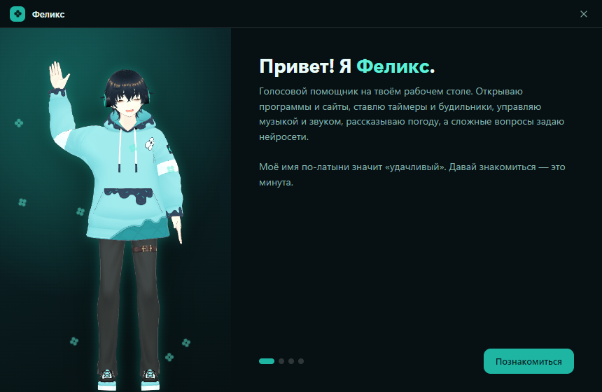
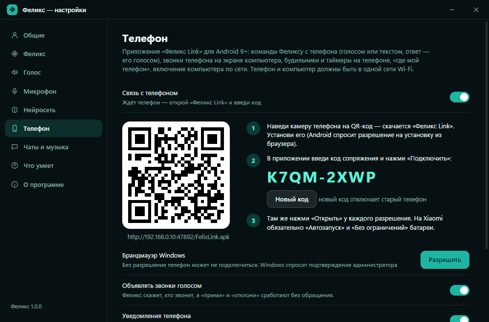

<div align="center">


# Феликс

**Голосовой 3D-помощник для рабочего стола Windows**

Скажи «Феликс» — он откроет программу, включит музыку, поставит таймер,<br>
расскажет погоду и ответит на любой вопрос. А телефон станет его пультом.

[](https://github.com/YatagarasuTS/felix-assistant/releases/latest)
[](https://github.com/YatagarasuTS/felix-assistant/releases)


<br>

<a href="https://github.com/YatagarasuTS/felix-assistant/releases/latest/download/FelixSetup-1.0.0.exe"></a>
<a href="https://github.com/YatagarasuTS/felix-assistant/releases/latest/download/Felix-1.0.0.exe"></a>
<a href="https://github.com/YatagarasuTS/felix-assistant/releases/latest/download/FelixLink-1.0.apk"></a>

<br><br>


</div>

---

## ✨ Что умеет

| Что | Например |
|---|---|
| 🗂️ **Программы и папки** | «открой загрузки», «закрой хром», «сверни дискорд», «найди файл отчёт» |
| ⏰ **Таймеры и будильники** | «таймер на пять минут», «напомни через час позвонить маме», «будильник на семь тридцать» |
| 🎵 **Музыка и звук** | «громче», «громкость 40», «следующий трек», «включи трек …», «переключи звук на наушники» |
| 🌦️ **Справка** | «какая погода», «погода в Казани завтра», «курс доллара», «что такое квазар» |
| 🌐 **Браузер** | «новая вкладка», «листай вниз», «зайди на хабр», «найди на ютубе котиков» |
| 💻 **Компьютер** | «сверни все окна», «сделай скриншот», «сколько места на диске», «выключи компьютер через час» |
| 🧠 **Любые вопросы** | «почему небо голубое?», «придумай тост на день рождения» — через нейросеть |
| 📱 **Телефон** | «где мой телефон», «прими» / «отклони» звонок, «будильник на телефоне на семь», «сколько заряда на телефоне» |

Позвать Феликса: сказать **«Феликс»** и команду, нажать **Win + Y** и говорить без обращения или просто кликнуть по нему.

## 🖼️ Как выглядит

<table>
  <tr>
    <td width="50%"></td>
    <td width="50%"></td>
  </tr>
  <tr>
    <td></td>
    <td></td>
  </tr>
</table>

<p align="center"><br><sub>Звонок с телефона — прямо на экране компьютера</sub></p>

## 🧠 Нейросеть — твой собственный аккаунт Claude

Встроенные команды работают сами, без интернета. Чтобы Феликс отвечал на любые вопросы, подключи **свой** аккаунт Anthropic:

1. **Настройки → Нейросеть → «Войти в аккаунт и создать ключ»** — откроется [console.anthropic.com](https://console.anthropic.com/settings/keys).
2. Войди (или зарегистрируйся) и создай ключ API.
3. Вставь ключ в Феликса и нажми **«Подключить»** — Феликс проверит его.

Запросы оплачиваются по твоему тарифу Anthropic, Феликс ничего не берёт. Ключ хранится только на твоём компьютере в зашифрованном виде (Windows DPAPI) и отправляется только в Anthropic.

> [!NOTE]
> Подписку claude.ai (Free, Pro, Max) сторонние программы по правилам Anthropic использовать не могут — нужен именно ключ API из твоего аккаунта.
> Не хочешь облако — подключи бесплатную локальную модель через [Ollama](https://ollama.com).

## 📱 Феликс Link для Android

Приложение-пульт для Android 9+. Телефон и компьютер должны быть в одной сети Wi-Fi.

- команды Феликсу с телефона — голосом или текстом, ответ его голосом;
- входящие звонки на экране компьютера: принять, отклонить, громкая связь;
- будильники и таймеры на телефоне, «Феликс, где мой телефон», уведомления;
- включение компьютера по сети (Wake-on-LAN).

**Как подключить:** Настройки → Телефон → включи «Связь с телефоном» → наведи камеру телефона на QR-код (или скачай APK по кнопке выше) → введи код сопряжения. Связь идёт только внутри твоей сети и шифруется (AES-256-GCM).

## 📦 Установка

| Файл | Что это |
|---|---|
| **FelixSetup-1.0.0.exe** | Установщик: ярлыки, запуск вместе с Windows, удаление через «Приложения». Права администратора не нужны. |
| **Felix-1.0.0.exe** | Переносная версия одним файлом: ничего не устанавливает, при первом запуске распаковывается (≈15 с) в `%LOCALAPPDATA%\Felix`, дальше открывается сразу. |
| **FelixLink-1.0.apk** | Приложение для телефона. Тот же файл Феликс раздаёт по QR-коду из настроек. |

> [!TIP]
> Программа пока без цифровой подписи, поэтому Windows может показать «Система Windows защитила ваш компьютер». Нажми **«Подробнее» → «Выполнить в любом случае»**.
> Android попросит разрешить установку из браузера — это нормально для APK не из Google Play.

**Требования:** Windows 10/11 x64, видеокарта с поддержкой WebGL, микрофон, около 550 МБ на диске. Для Феликс Link — Android 9 или новее.

## 🔒 Приватность

- Речь распознаётся и голос синтезируется **прямо на компьютере** — записи голоса никуда не уходят.
- В интернет уходят только вопросы к выбранной нейросети и запросы погоды, курсов, Википедии и поиска музыки — по твоей команде.
- Никакой статистики и рекламы.

## 🔑 Контрольные суммы (SHA-256)

```
2e3bfd5f7021dfd0a9b2e5efb2fb16944f99a064e7170607dc3be6751f390c88  FelixSetup-1.0.0.exe
ab44b1bcf7c68fc12de50439e16b2947ec2865f993b0e9ec62e0dcdc99d7d358  Felix-1.0.0.exe
70989a9b21eeadeb0ec21bd16e85a3e14ec71d9f4dc7405bba8dfe0062cd3f3f  FelixLink-1.0.apk
```

Проверить: `Get-FileHash .\FelixSetup-1.0.0.exe` в PowerShell.

## 📄 Лицензия

Феликс бесплатен для личного и рабочего использования — условия в [LICENSE.txt](LICENSE.txt).
Сторонние компоненты (Electron, three.js, three-vrm, Vosk, Piper, голоса Piper, Anthropic SDK и др.) — в [THIRD-PARTY-NOTICES.txt](THIRD-PARTY-NOTICES.txt).

<div align="center"><sub>Felix по-латыни значит «удачливый» 🍀</sub></div>
