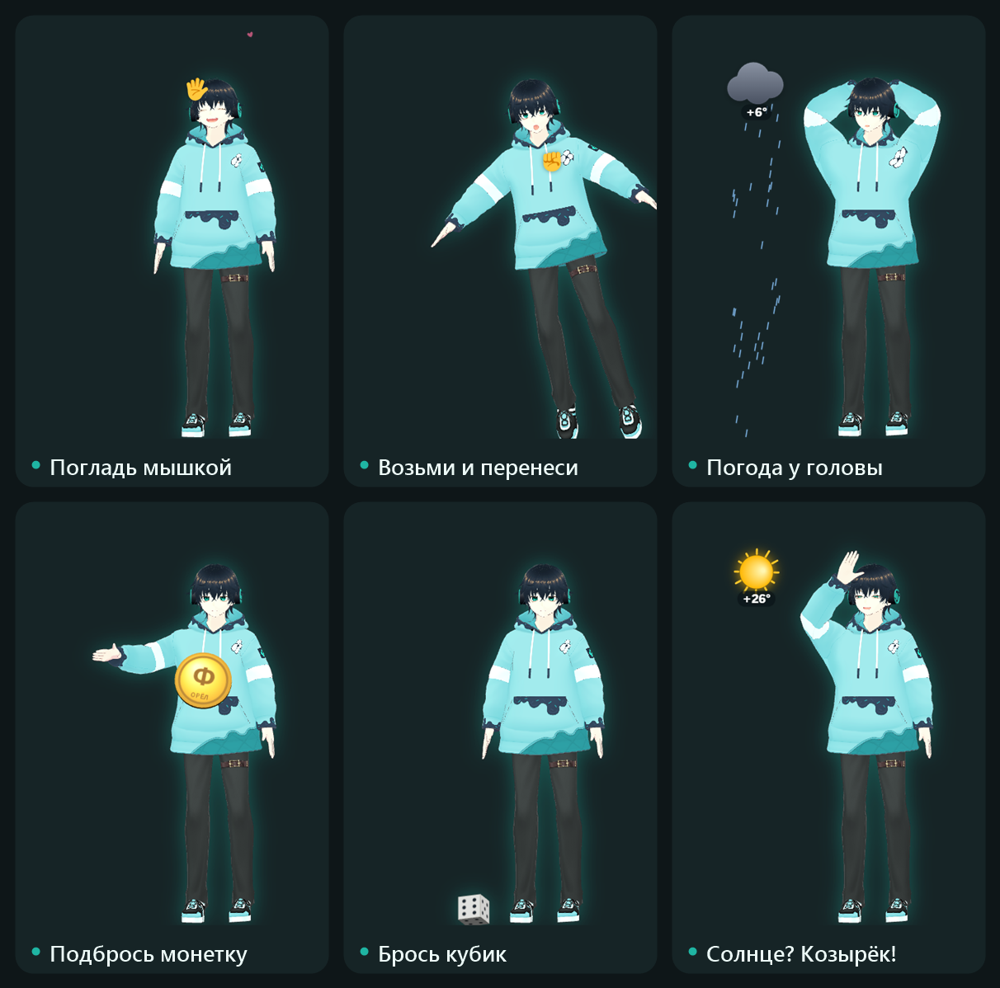
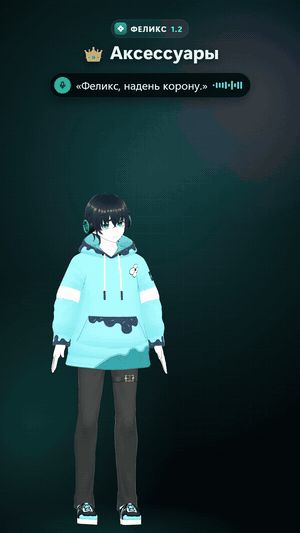
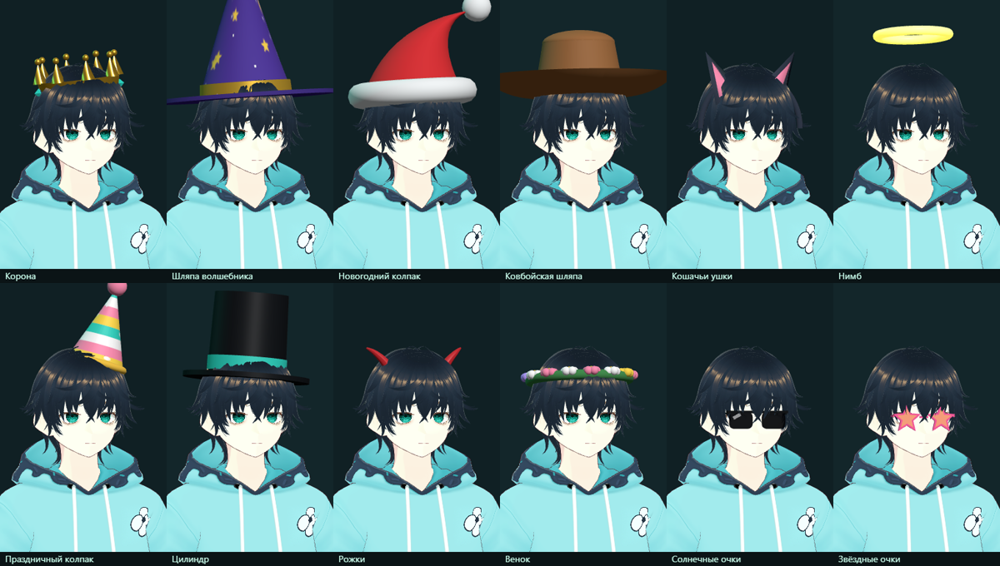
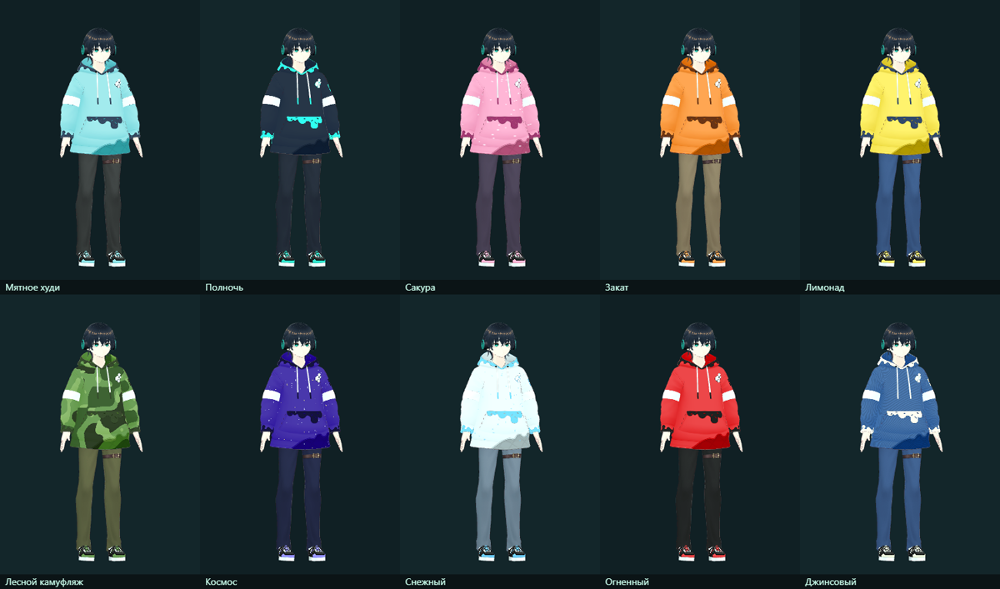
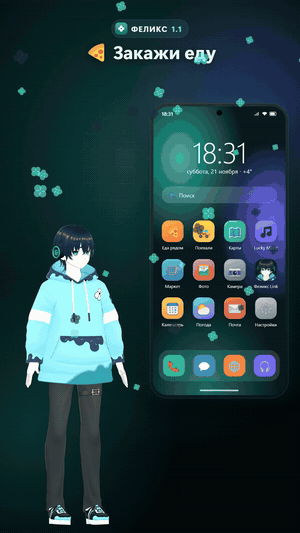
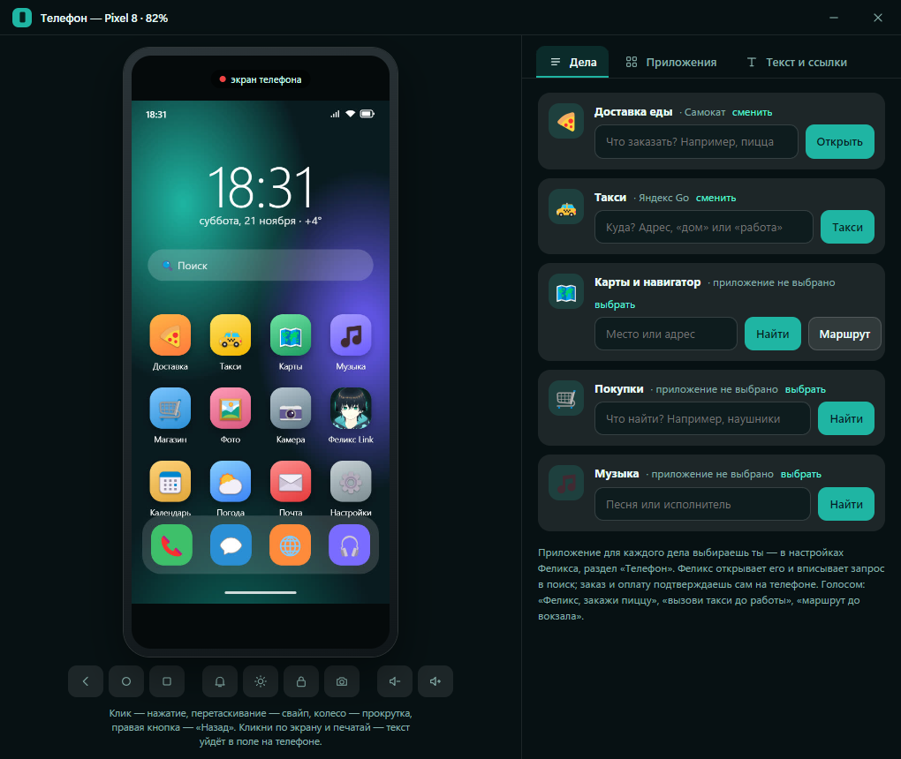
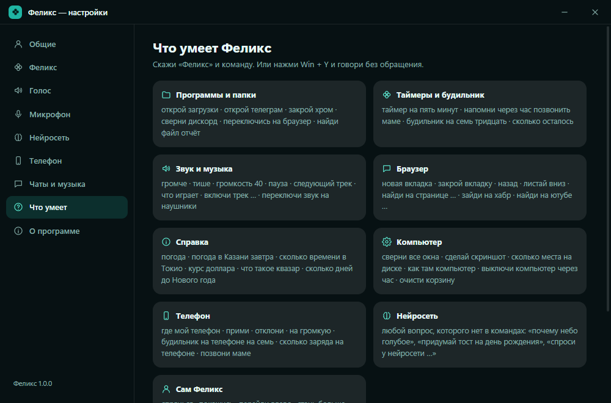
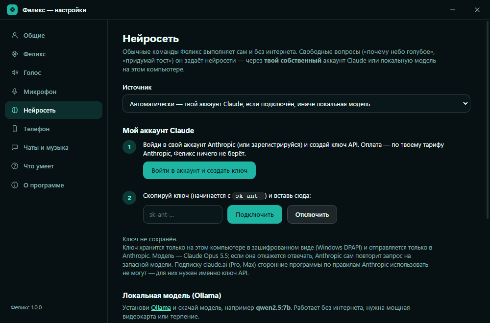
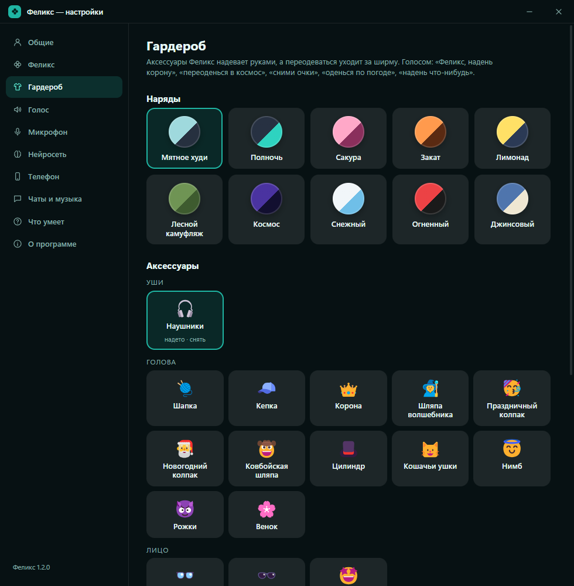
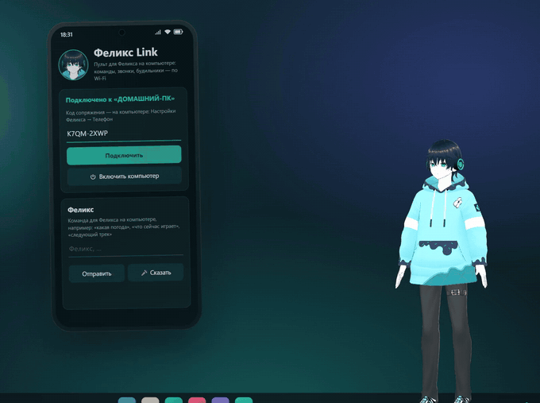

<div align="center">


# Феликс

**Голосовой 3D-помощник для рабочего стола Windows — и пульт для твоего телефона**

Скажи «Феликс» — он откроет программу, включит музыку, поставит таймер,<br>
расскажет погоду, ответит на любой вопрос, закажет пиццу на твоём телефоне —<br>а ещё переоденется за ширмой, зажмурится, если погладить его мышкой,<br>и покажет экран телефона на компьютере живым видео.

[](https://github.com/YatagarasuTS/felix-assistant/releases/latest)
[](https://github.com/YatagarasuTS/felix-assistant/releases)
[](LICENSE)


<br>

<a href="https://github.com/YatagarasuTS/felix-assistant/releases/latest/download/FelixSetup-1.3.0.exe"></a>
<a href="https://github.com/YatagarasuTS/felix-assistant/releases/latest/download/Felix-1.3.0.exe"></a>
<a href="https://github.com/YatagarasuTS/felix-assistant/releases/latest/download/FelixLink-1.2.apk"></a>

<br><br>


</div>

---

## ✨ Что умеет

| Что | Например |
|---|---|
| 🗂️ **Программы и папки** | «открой загрузки», «закрой хром», «сверни дискорд», «найди файл отчёт» |
| ⏰ **Таймеры и будильники** | «таймер на пять минут», «напомни через час позвонить маме», «будильник на семь тридцать» |
| 🎵 **Музыка и звук** | «громче», «громкость 40», «следующий трек», «включи трек …», «переключи звук на наушники» |
| 🌦️ **Справка** | «какая погода», «погода в Казани завтра», «курс доллара», «что такое квазар» |
| 🌐 **Браузер** | «новая вкладка», «листай вниз», «зайди на хабр», «найди на ютубе котиков» |
| 💻 **Компьютер** | «сверни все окна», «сделай скриншот», «сколько места на диске», «выключи компьютер через час» |
| 🧠 **Любые вопросы** | «почему небо голубое?», «придумай тост на день рождения» — через нейросеть |
| 📱 **Телефон** | «где мой телефон», «прими» / «отклони» звонок, «будильник на телефоне на семь», «сколько заряда на телефоне» |
| 📲 **Телефон с компьютера** · 60 к/с | «покажи экран телефона» — живое видео, мышь как палец; «закажи пиццу», «вызови такси до работы», «открой покупки», «на телефоне назад» |
| 🐾 **Живой Феликс** · новое | погладь мышкой по голове, возьми и перенеси (и урони), «подбрось монетку», «брось кубик», «какая погода» — тучка у головы, танцует под твою музыку |
| 👕 **Гардероб** | «надень корону», «надень что-нибудь», «сними очки», «переоденься в космос», «оденься по погоде», «что на тебе» |
| 🎮 **Игры и забота** | «камень, ножницы, бумага», «загадай число», «загадай загадку», «запусти помидор», «напоминай пить воду», «сделай селфи», «подними настроение» |

Позвать Феликса: сказать **«Феликс»** и команду, нажать **Win + Y** и говорить без обращения или просто кликнуть по нему.

## 🐾 Живой Феликс · новое в 1.3

<p align="center"></p>

- **Погладь мышкой.** Поводи курсором туда-сюда над макушкой — Феликс зажмурится, подставит голову под руку, полетят сердечки, а потом скажет что-нибудь приятное. Курсор над головой становится ладошкой.
- **Возьми и перенеси.** Нажми на Феликса и веди — он повиснет, болтая ногами, и будет раскачиваться от скорости. Отпустишь — упадёт на «пол» над панелью задач, подпрыгнет и приземлится (с высоты — с кружащейся головой). Новое место он запомнит; «Слева/Справа» в настройках вернёт в угол.
- **Монетка и кубик в 3D:** «подбрось монетку» — подкидывает, ловит и показывает орла или решку; «брось кубик» — кубик кувыркается по полу и ложится честной стороной.
- **Погода у головы:** на «какая погода» рядом появляется солнце, тучка с дождём, снег, гроза или туман с температурой — и Феликс реагирует: от солнца прикрывается ладонью, от дождя — руками над головой, в мороз греет ладони.
- **Танцует под музыку:** играет музыка на компьютере (Яндекс Музыка, YouTube, Spotify — любой плеер Windows) — Феликс пританцовывает, над ним летят нотки. Выключается в Настройках → Феликс.

## 👕 Гардероб: 10 нарядов и 23 аксессуара

<p align="center"></p>

- **Аксессуары Феликс надевает руками:** поднимает ладони, вещь появляется в руках и плывёт на место. Корона, шляпа волшебника, новогодний и праздничный колпак, ковбойская шляпа, цилиндр, кепка, шапка, кошачьи ушки, нимб, рожки, венок, очки (обычные, солнечные, звёздные), шарф, бабочка, медаль, крылья, рюкзак, зонт и воздушный шарик в руке, наушники.
- **Переодевается за ширмой:** ширма раскрывается, Феликс заходит за неё, старое худи перелетает через верх — и он выходит в новом наряде. Наряды: «Мятное худи», «Полночь», «Сакура», «Закат», «Лимонад», «Лесной камуфляж», «Космос» со звёздами, «Снежный», «Огненный», «Джинсовый».
- **«Оденься по погоде»** — смотрит прогноз: в мороз шапка и шарф, в дождь зонт, в жару кепка и солнечные очки.
- **Праздники:** на Новый год сам наденет колпак, на Хэллоуин — шляпу волшебника, 8 марта — венок (можно выключить).
- Всё выбирается и мышью: **Настройки → Гардероб**.

<table>
  <tr>
    <td width="50%"></td>
    <td width="50%"></td>
  </tr>
</table>

## 🎮 Игры и забота

- **Игры голосом:** «камень, ножницы, бумага», «загадай число» (Феликс подсказывает «больше/меньше»), «загадай загадку».
- **Помидор:** «запусти помидор» — 25 минут работы, 5 отдыха, каждый четвёртый перерыв длинный; «сколько осталось помидора», «стоп помидор».
- **Забота:** «напоминай пить воду» (раз в час) и «напоминай размяться» (каждые 50 минут) — только пока ты за компьютером.
- **Погладь Феликса** мышкой по голове — зажмурится от удовольствия, вокруг полетят сердечки.
- **«Сделай селфи»** — Феликс позирует, снимок с подписью сохраняется в «Изображения\Феликс».
- **«Подними настроение»** — поддержит добрым словом.

## 📲 Управление телефоном с компьютера

<table>
  <tr>
    <td width="34%" align="center"></td>
    <td></td>
  </tr>
</table>

- **Дела голосом.** «Феликс, закажи пиццу» — откроется *твоё* приложение доставки, и Феликс впишет «пицца» в поиск. «Вызови такси до работы» — такси с готовым маршрутом. «Маршрут до вокзала» — карты или навигатор. «Купи наушники», «найди на озоне …» — магазин.
- **Приложение выбираешь ты** — любое на телефоне: Настройки → Телефон → «Приложения для дел». Не выбрал — Феликс найдёт подходящее сам или спросит: «Через какое: Яндекс Еда или Самокат?». Адреса «дом» и «работа» — там же.
- **Заказываешь всё равно ты.** Феликс открывает приложение и вписывает запрос; заказ, оплату и поездку подтверждаешь сам на телефоне.
- **Экран телефона на компьютере — живым видео** (новое в 1.3): окно «Телефон» в трее или «Феликс, покажи экран телефона». Телефон сжимает экран своим аппаратным кодером H.264 и шлёт до 60 кадров в секунду, компьютер расшифровывает и показывает с задержкой в доли секунды — как сам телефон. Раньше были снимки экрана ~3 раза в секунду.
- **Мышь — как палец, вживую:** нажал — палец опустился, ведёшь — палец двигается следом (листать, тянуть шторку, рисовать, играть), отпустил — поднялся. Колесо — прокрутка, правая кнопка — «Назад», средняя — «Домой», печатаешь на клавиатуре — текст уходит в поле на телефоне.
- **«Открой покупки», «открой такси», «открой навигатор»** — если на компьютере такого нет, а телефон на связи, Феликс откроет нужное приложение на телефоне.
- **Кнопки и мелочи:** «на телефоне назад / домой», «заблокируй телефон», «напиши на телефоне …», «отправь текст на телефон», «открой ссылку на телефоне» (скопированную на компьютере), список всех приложений телефона одним кликом.

Нужен «Феликс Link» 1.2. При первом показе экрана Android спросит «Начать трансляцию?» — нажми «Начать» (разрешение держится, пока открыто окно, и ещё 10 минут после). Касания мышью работают через службу «Феликс Link — управление с компьютера» (специальные возможности). Видео идёт только пока окно «Телефон» открыто и не свёрнуто; если Windows спросит про брандмауэр — разреши (порты Феликса, только домашняя сеть).

## 🖼️ Как выглядит

<table>
  <tr>
    <td width="50%"></td>
    <td width="50%"></td>
  </tr>
  <tr>
    <td></td>
    <td></td>
  </tr>
</table>

<p align="center"><br><sub>Звонок с телефона — прямо на экране компьютера</sub></p>

## 🧠 Нейросеть — твой собственный аккаунт Claude

Встроенные команды работают сами, без интернета. Чтобы Феликс отвечал на любые вопросы, подключи **свой** аккаунт Anthropic:

1. **Настройки → Нейросеть → «Войти в аккаунт и создать ключ»** — откроется [console.anthropic.com](https://console.anthropic.com/settings/keys).
2. Войди (или зарегистрируйся) и создай ключ API.
3. Вставь ключ в Феликса и нажми **«Подключить»** — Феликс проверит его.

Запросы оплачиваются по твоему тарифу Anthropic, Феликс ничего не берёт. Ключ хранится только на твоём компьютере в зашифрованном виде (Windows DPAPI) и отправляется только в Anthropic.

> [!NOTE]
> Подписку claude.ai (Free, Pro, Max) сторонние программы по правилам Anthropic использовать не могут — нужен именно ключ API из твоего аккаунта.
> Не хочешь облако — подключи бесплатную локальную модель через [Ollama](https://ollama.com).

## 📱 Феликс Link для Android

Приложение-пульт для Android 9+. Телефон и компьютер должны быть в одной сети Wi-Fi.

<p align="center"></p>

- команды Феликсу с телефона — голосом или текстом, ответ его голосом;
- управление телефоном с компьютера: дела (доставка, такси, карты, магазины, музыка), экран телефона на ПК живым видео до 60 к/с, мышь как палец, кнопки, ввод текста;
- входящие звонки на экране компьютера: принять, отклонить, громкая связь;
- будильники и таймеры на телефоне, «Феликс, где мой телефон», уведомления;
- включение компьютера по сети (Wake-on-LAN).

**Как подключить:** Настройки → Телефон → включи «Связь с телефоном» → наведи камеру телефона на QR-код (или скачай APK по кнопке выше) → введи код сопряжения. Связь идёт только внутри твоей сети и шифруется (AES-256-GCM).

## 📦 Установка

| Файл | Что это |
|---|---|
| **FelixSetup-1.3.0.exe** | Установщик: ярлыки, запуск вместе с Windows, удаление через «Приложения». Права администратора не нужны. Ставится поверх прошлых версий — настройки сохраняются. |
| **Felix-1.3.0.exe** | Переносная версия одним файлом: ничего не устанавливает, при первом запуске распаковывается в `%LOCALAPPDATA%\Felix`, дальше открывается сразу. |
| **FelixLink-1.2.apk** | Приложение для телефона. Тот же файл Феликс раздаёт по QR-коду из настроек. Ставится поверх 1.0 и 1.1. |

> [!TIP]
> Программа пока без цифровой подписи, поэтому Windows может показать «Система Windows защитила ваш компьютер». Нажми **«Подробнее» → «Выполнить в любом случае»**.
> Android попросит разрешить установку из браузера — это нормально для APK не из Google Play.

**Требования:** Windows 10/11 x64, видеокарта с поддержкой WebGL, микрофон, около 550 МБ на диске. Для Феликс Link — Android 9 или новее (экран телефона на компьютере — тоже с Android 9).

## 🔒 Приватность

- Речь распознаётся и голос синтезируется **прямо на компьютере** — записи голоса никуда не уходят.
- В интернет уходят только вопросы к выбранной нейросети и запросы погоды, курсов, Википедии и поиска музыки — по твоей команде.
- Связь с телефоном — только внутри твоей сети, без серверов. Экран телефона виден на компьютере, только пока открыто окно «Телефон»; видео шифруется тем же ключом сопряжения (AES-256-GCM), а Android сам показывает значок трансляции.
- Никакой статистики и рекламы. Весь код открыт — можно проверить.

## 💚 Открытый код

Феликс — свободная программа под лицензией [MIT](LICENSE): весь код программы, «Феликс Link», установщика и роликов открыт. Можно изучать, менять, собирать свою версию и распространять.

- [docs/BUILDING.md](docs/BUILDING.md) — устройство проекта, сборка из исходников, протокол связи с телефоном;
- [CONTRIBUTING.md](CONTRIBUTING.md) — как сообщить об ошибке и прислать улучшение;
- [SECURITY.md](SECURITY.md) — как сообщить об уязвимости.

```
app/      программа (Electron): команды, нейросеть, окна, связь с телефоном
phone/    «Феликс Link» для Android (Kotlin)
native/   помощники на C#: окна, громкость, распознавание речи Vosk, клавиши
build/    сборка установщика и APK         promo/   рекламные ролики
```

## 🔑 Контрольные суммы (SHA-256)

```
ea3c5d66537c0a511b3de6100bb55358025074357a399485ffd299d45c2cf9b9  FelixSetup-1.3.0.exe
be08026ecf6e6fb09e0468c573e0820ced2e6e23526821f094ad47ed834a6b6a  Felix-1.3.0.exe
4eb3844965fb175748d1b9a9a758825b582e02092fd3aef8cb63c834d4684d2f  FelixLink-1.2.apk
```

Проверить: `Get-FileHash .\FelixSetup-1.3.0.exe` в PowerShell.

## 📄 Лицензия

[MIT](LICENSE) © 2026 YatagarasuTS и участники проекта.
Сторонние компоненты (Electron, three.js, three-vrm, Vosk, Piper, голоса Piper, Anthropic SDK и др.) — на условиях своих лицензий, см. [THIRD-PARTY-NOTICES.txt](THIRD-PARTY-NOTICES.txt).

<div align="center"><sub>Felix по-латыни значит «удачливый» 🍀</sub></div>
