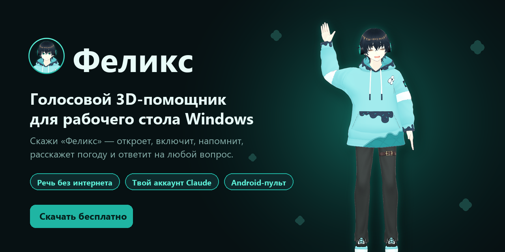

<p align="center"></p>

## Феликс 1.3 — живой Феликс и телефон без тормозов 🐾📱

### Экран телефона — живым видео
- **До 60 кадров в секунду вместо ~3.** Телефон сжимает экран своим аппаратным кодером H.264 и шлёт видеопоток, компьютер показывает его через аппаратный декодер — с задержкой в доли секунды, как сам телефон. Работает на Android 9+ (раньше — только 11+).
- **Мышь — как палец, вживую:** нажал — палец опустился, ведёшь — он движется следом (листать ленту, тянуть шторку, играть), отпустил — поднялся. Раньше жест отправлялся только после отпускания.
- В первый раз Android спросит «Начать трансляцию?»; если окно не появилось — на телефоне будет уведомление «Показать экран на компьютере?». Разрешение держится, пока открыто окно, и ещё 10 минут.
- Видео шифруется тем же ключом сопряжения (AES-256-GCM), к каждой трансляции — разовый пропуск. Свернул окно — телефон перестаёт передавать.

### Живой Феликс
- **Погладь мышкой** — поводи курсором над макушкой: Феликс зажмурится, подставит голову под руку, полетят сердечки. Раньше поглаживание почти не срабатывало — исправлено.
- **Возьми и перенеси** — схватил мышью, и он висит, болтая ногами и раскачиваясь; отпустил — падает на «пол», подпрыгивает и приземляется (с высоты — с кружащейся головой). Новое место запоминается.
- **«Подбрось монетку», «брось кубик»** — настоящие 3D-монетка и кубик, результат объявляется, когда упадут.
- **Погода у головы** — солнце, тучка с дождём, снег, гроза, туман и температура; Феликс прикрывается от солнца ладонью, от дождя — руками, в мороз греет ладони.
- **Танцует под музыку**, которая играет на компьютере (переключатель в Настройках → Феликс), и по команде «станцуй».

### Исправлено
- «Открой покупки», «открой такси», «открой навигатор» при подключённом телефоне открывают приложение на телефоне (раньше — «Не нашёл приложение»).
- «Включи музыку», когда ничего не играет, открывает выбранный музыкальный сервис (YouTube Music или Яндекс Музыку).
- «Покажи телефон» выводит окно «Телефон» вперёд, даже если оно свёрнуто или за другими окнами.
- «Убери телеграм» сворачивает окно, а не открывает Телеграм.
- Окно «Телефон»: правая колонка больше не обрезается; трансляция не прерывается, когда окно перекрыто другим.

### Что скачать
| Файл | Для чего |
|---|---|
| **FelixSetup-1.3.0.exe** | Установка или обновление поверх 1.0–1.2 (настройки сохраняются). Без прав администратора. |
| **Felix-1.3.0.exe** | Переносная версия одним файлом, без установки. |
| **FelixLink-1.2.apk** | «Феликс Link» для Android 9+: видео экрана и касания вживую. Ставится поверх 1.0 и 1.1. |

Программа пока без цифровой подписи: если Windows предупреждает — «Подробнее» → «Выполнить в любом случае».

### SHA-256
```
ea3c5d66537c0a511b3de6100bb55358025074357a399485ffd299d45c2cf9b9  FelixSetup-1.3.0.exe
be08026ecf6e6fb09e0468c573e0820ced2e6e23526821f094ad47ed834a6b6a  Felix-1.3.0.exe
4eb3844965fb175748d1b9a9a758825b582e02092fd3aef8cb63c834d4684d2f  FelixLink-1.2.apk
```
